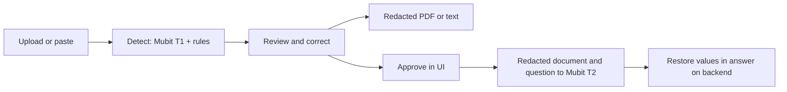

# Veil

**Review sensitive information before sharing a document with an answering AI.**

Veil finds personal values in documents, lets you correct the redactions, and
replaces those values with placeholders for document Q&A. It restores names and
other values in the answer so the result remains useful to you. Built for the
Mubit Night Shift hackathon in London, 23–25 October 2026.

[Open the app](https://web-production-dc019.up.railway.app/app) ·
[Documentation](docs/README.md) · [Architecture](docs/ARCHITECTURE.md) ·
[Mubit integration](docs/MUBIT.md) · [Data protection](docs/SECURITY.md)

> **Current privacy boundary:** detection sends original document chunks through
> Mubit, with recording enabled by default. Q&A receives the redacted document
> and a filtered question. Veil does not yet guarantee that original personal
> data never reaches an external AI provider. Use synthetic documents for demos;
> see [implemented protections and limits](docs/SECURITY.md).

## How it works



1. **Sign in and add a document.** Register with email/password, paste text,
   upload a text PDF or supported text file, or choose an invented sample.
2. **Watch detection.** Model results and UK identifier rules identify names,
   addresses, contact details, accounts and references. Each part shows its
   status and Mubit request ID; failed parts can be retried.
3. **Review the result.** Hide a missed value or show a false positive. Corrections
   are saved and survive rescans, retries and reloads.
4. **Ask about it.** Approve in the interface to open Q&A. Detected values become
   placeholders in the document and question; the backend restores them in the
   answer. “What it sees” shows the redacted content used by the app.
5. **Download and return later.** Export redacted text or a PDF with covered text
   and pixels removed. Saved documents, review status and chat history persist
   in PostgreSQL under your account.

Illustrative transformation:

| Stage | Text |
| --- | --- |
| Original | `Tenant: Raj Patel. Rent: £950.` |
| Redacted document | `Tenant: [PERSON_1]. Rent: £950.` |
| Question sent to T2 | `What does [PERSON_1] pay?` |
| Answer shown to the user | `Raj Patel pays £950.` |

The vault stays on the backend and is encrypted in storage. This is reversible
pseudonymisation, not a guarantee of anonymity or perfect detection.

## Mubit and data protection

**T1 detects; T2 answers.** Both use Mubit. The default T1 request asks
`claude-haiku-4-5` to rewrite a chunk with placeholders; Veil aligns that answer
back to the original text and combines it with deterministic rules. T2 receives
the redacted result and a pseudonymised question with recording off requested.
Model routing and adapter rollout are configured in Mubit, not proven by the
model name displayed in the app.

Recorded T1 calls can become reviewed training examples. **In-app corrections
are not automatically sent as Mubit training feedback.** See the
[Mubit guide](docs/MUBIT.md) for task/session grouping, dataset paths, review,
training, evaluation and routing.

Accounts isolate documents; Argon2id protects passwords; server-side sessions
use HttpOnly cookies; Fernet encrypts document content, vaults and chat at rest.
The backend can decrypt this data. Approval is saved but is currently enforced
by the UI rather than the `/ask` endpoint. Question filtering can miss unfamiliar
free-form values. Read the [security guide](docs/SECURITY.md) before making
privacy claims about a deployment.

## Run locally

Prerequisites: Python 3.12 or 3.13, uv, Node compatible with the frontend lockfile,
and PostgreSQL 16+ binaries on PATH. All setup commands below start at the
repository root. See [database setup](docs/DATABASE.md) for details.

```sh
# First setup only: preserve an existing .env rather than replacing it.
test -f .env || cp .env.example .env
# Edit .env to set MUBIT_API_KEY if model calls are wanted.
python3 scripts/local_db.py start
```

Backend, in one terminal:

```sh
cd backend
uv sync --frozen
uv run --env-file ../.env uvicorn app.main:app --reload --host 127.0.0.1 --port 8000
```

Frontend, in another terminal:

```sh
npm --prefix frontend ci
npm --prefix frontend run dev -- --host 127.0.0.1 --port 5173
```

Open <http://127.0.0.1:5173/app>. Without a Mubit key, rule-based detection still
works and Q&A is unavailable. Photos, scans and mixed PDFs needing OCR require
Apple Vision on macOS; that path is unavailable on the Linux Railway deployment.

## Verify changes

Run each command from the repository root:

```sh
(cd backend && uv run --env-file ../.env pytest -q)
(cd backend && uv run --with reportlab python -m pytest -q ../tests/ingest)
(cd evalkit && uv run pytest -q)
npm --prefix frontend test
npm --prefix frontend run build
```

Backend integration tests need a separate `TEST_DATABASE_URL`, created by the
local setup script. Without it, those tests skip; do not interpret skips as a
passed database check. Model calls are mocked in backend tests. Dataset checks
and generation commands are in the [dataset guide](data/README.md).

## Explore the project

- [Architecture](docs/ARCHITECTURE.md): system, document and Q&A diagrams.
- [Mubit](docs/MUBIT.md): inference, sessions, training and verification.
- [Data protection](docs/SECURITY.md): trust boundaries, controls and gaps.
- [Saved data](docs/DATABASE-CONTENTS.md) and [database operations](docs/DATABASE.md).
- [Developer handoff](docs/HANDOFF.md), [deployment](docs/DEPLOY.md), [design system](DESIGN.md).
- [All documentation](docs/README.md), including datasets and historical research.
