<p align="center">
  
</p>

<p align="center">
  <a href="https://muguard.up.railway.app/app"></a>
  &nbsp;
  <a href="https://muguard.up.railway.app/app?sample=01_tenancy_agreement.pdf"></a>
</p>

<p align="center">
  <a href="docs/README.md">Documentation</a> ·
  <a href="docs/ARCHITECTURE.md">Architecture</a> ·
  <a href="docs/MUBIT.md">Mubit integration</a> ·
  <a href="docs/SECURITY.md">Data protection</a> ·
  <a href="DESIGN.md">Design system</a>
</p>

**Review sensitive information before sharing a document with an answering AI.**

71% of UK workers have used AI tools their employer never approved, and two in
three ChatGPT writing requests rework text people paste in: contracts, payslips,
client letters. Every name in them rides out to the model provider
([sources](docs/research/2026-10-24-veil-numbers/README.md)).

MuGuard keeps them inside the walls. It finds personal values in documents, lets
you correct the redactions, and replaces those values with placeholders before an
AI answers questions about the document. It restores names and other values in
the answer so the result remains useful to you, and its detection task is trained
through Mubit. Built by Mykola, Glib and Dmytro for the Mubit Night Shift
hackathon in London, 23–25 October 2026, with FastAPI, PostgreSQL, React and Mubit.

> **Current privacy boundary:** the AI that answers your questions only ever sees
> placeholders. Finding the names takes one pass over the original text through
> Mubit, which records it to train the knight, MuGuard's own redaction model.
> Until Mubit routes that pass to the knight, `claude-haiku-4-5` makes it, so the
> original text still reaches a model provider. Use synthetic documents for demos;
> see [implemented protections and limits](docs/SECURITY.md).

## What the demo shows

<p align="center">
  
</p>

The two-minute video follows the same story as this README:

| Time | Chapter | What you see |
| --- | --- | --- |
| 0:02 | The problem | 71% of UK workers use AI tools their employer never approved, and every name in the text they paste rides out to the model provider. |
| 0:16 | What MuGuard is | The castle: names are hidden before the answering AI sees them, and the real values come back in the answer. |
| 0:25 | Three ways to train | One job, three Mubit accounts: 180 realistic documents, 576 synthetic cases, 100,000 generated documents. Only the realistic set cleared Mubit's 85% bar ([details](#three-ways-to-train-one-student)). |
| 0:56 | Quest 1: drop a document | A tenancy agreement is read part by part, with rules for UK numbers. |
| 1:03 | Quest 2: review | Every name, address and number is struck out, and each part is its own Mubit call with a request id. |
| 1:16 | Quest 3: fix a miss | The landlord is our client, so the name is marked and hidden by hand. |
| 1:25 | Quest 4: approve | Only after approval may the document pass the gate. |
| 1:30 | Quest 5: ask the AI | When may the landlord raise the rent? The AI sees placeholders; MuGuard puts the true names back. |
| 1:39 | What the AI received | The exact text the AI got: no names, no addresses, no account numbers. |
| 1:45 | Results | Rules alone catch no names; the Mubit adapter matched the teacher on 91.7% of its held-out test (11 of 12 cases), against 66.7% for the base model. |

For a steady take, the app scenes in the video run on a mock stream. The
screenshot below is the same flow on the real model through Mubit.

<p align="center">
  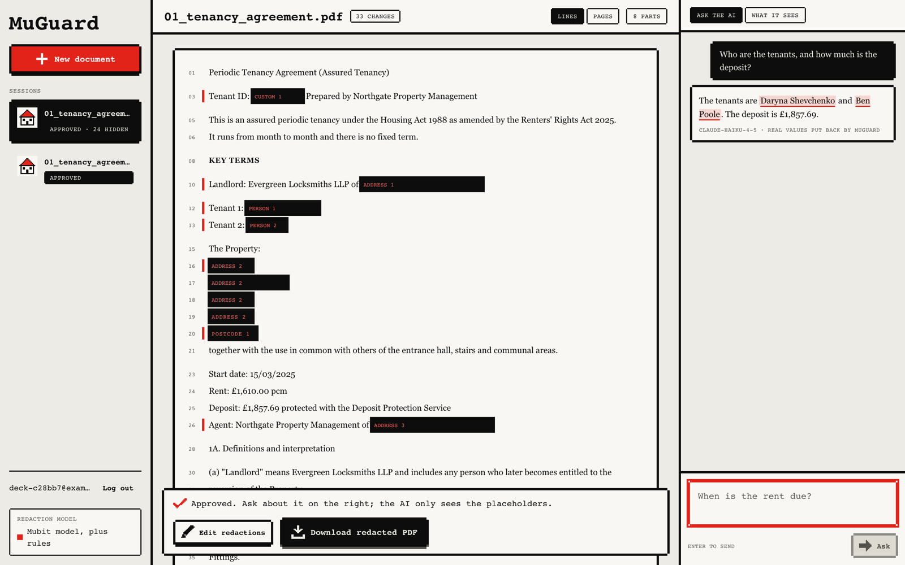
</p>
<p align="center"><sub>A real run of the app on the synthetic tenancy sample, with claude-haiku-4-5 through Mubit: the approved document and the answer with the names put back.</sub></p>

<details>
<summary>How the video was made, and what in it is a recording aid</summary>

The video is built from code in [`demo/`](demo/README.md): Playwright records the
app, a British voice is generated locally with Kokoro, and the edit is rendered in
pixel art. In the mock stream behind the app scenes
(`frontend/scripts/mock-stream.mjs`) the detector returns the sample's answer key,
request ids read `mreq_mock`, and the answer comes from the mock. The screenshot
above is the same flow on the real model, without the hand fix of Quest 3. Three
lines of the narration describe where MuGuard is heading rather than this build:
detection is answered today by claude-haiku-4-5 through Mubit while the trained
adapter waits for its rollout; a fix in the app is saved for that document but is
not yet sent to Mubit as training feedback; and the real values are put back by
MuGuard's backend.

</details>

## How it works

<p align="center">
  
</p>

1. **Ingest.** The browser sends the document to Caddy, which forwards `/api`
   to the private backend. The backend extracts text and word positions and saves
   the source encrypted.
2. **Detect, two ways at once.** Deterministic rules find structured values
   (emails, phones, postcodes, sort codes, account numbers, IBANs, cards, NI,
   passport, licence and NHS numbers, IP addresses and labelled references).
   In parallel the text is split into chunks, and each chunk goes to **T1**, the
   detection call, through Mubit, which returns it rewritten with placeholders.
   MuGuard aligns that rewrite back to the original to recover the exact values.
3. **Build.** Every value found anywhere is located throughout the document,
   overlaps are merged, and each distinct value gets a stable placeholder in the
   vault (`Raj Patel` → `[PERSON_1]`). Progress streams to the browser chunk by chunk.
4. **Review.** Hiding or unhiding a value rebuilds the result locally, with no
   model call, and the correction survives rescans.
5. **Ask.** Only an approved document passes the gate: the question box opens
   after you approve, and the API refuses questions about a document you have not
   approved. The question is pseudonymised with the same vault, then **T2**, the
   answering call, receives only the redacted document and redacted question. The
   backend swaps placeholders back to real values before the answer is shown.
6. **Download.** The PDF is truly redacted: covered text and image pixels are
   removed from the file and hidden metadata is stripped. It is not a black box
   drawn on top.

<details>
<summary><b>What runs where</b></summary>

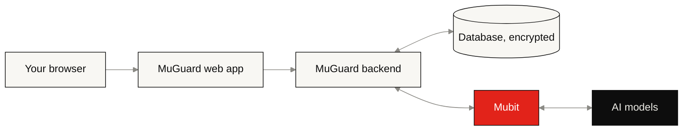

The browser only talks to the web app. The backend holds the database, the
encryption key and the Mubit key, and is not reachable from the internet.
Every AI call goes through Mubit.

</details>

<details>
<summary><b>Full pipeline diagram</b></summary>

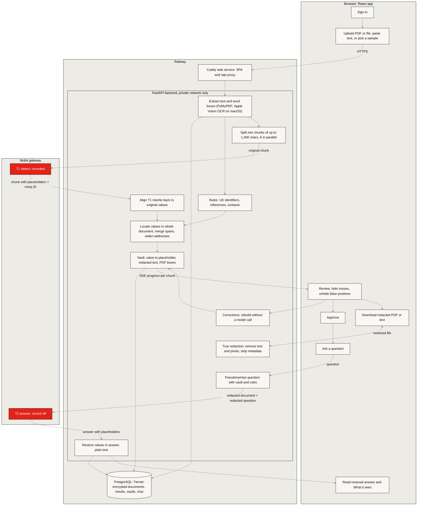

</details>

## What the AI provider receives

<p align="center">
  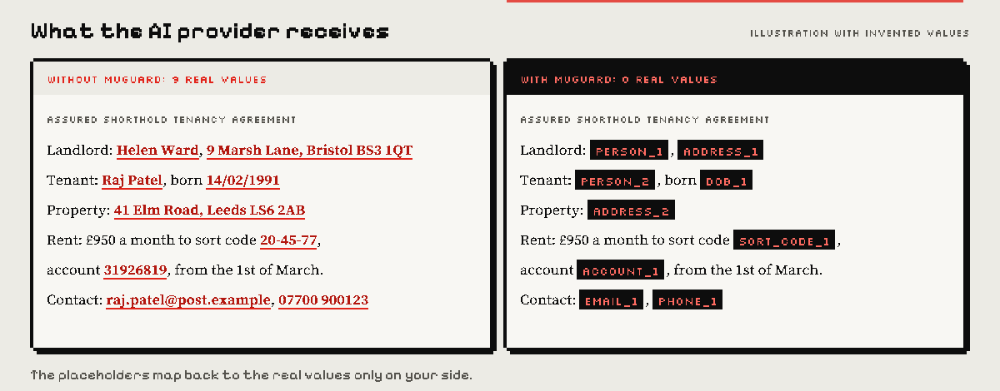
</p>

| Stage | Text |
| --- | --- |
| Original | `Tenant: Raj Patel. Rent: £950.` |
| Redacted document | `Tenant: [PERSON_1]. Rent: £950.` |
| Question sent to T2 | `What does [PERSON_1] pay?` |
| Answer shown to the user | `Raj Patel pays £950.` |

The vault stays on the backend and is encrypted in storage. This is reversible
pseudonymisation, not a guarantee of anonymity or perfect detection.

## The numbers

<p align="center">
  
</p>

Rules are near perfect on structured formats and blind to names; the model reads
names and addresses but misses most unlabelled client codes. MuGuard runs both on
every chunk, so each covers the other's gaps. Measured with
[`scripts/readme_numbers.py`](scripts/readme_numbers.py) on 140 chunks of the
fresh synthetic round: the `claude-haiku-4-5` rewrite answers already sent
through Mubit were scored offline against the answer key, with no new model calls.
A value counts only when every character of it is hidden. In the earlier
baseline the video quotes, 1,459 synthetic UK documents, the pattern rules alone
hid 38.5% of personal values and no names at all: names need a model.

## Trained through Mubit

<p align="center">
  
</p>

### Three ways to train, one student

<p align="center">
  
</p>

Mubit records calls to a big teacher model and trains a small one to copy it. We
trained the same student, Qwen3-4B-Instruct-2507, three ways, each on its own
Mubit account: Mykola with 180 realistic documents (public UK templates filled
with invented values) and a rewrite answer, Glib with 576 synthetic cases in 12
scenario families and a span answer, and Dmytro with 100,000 generated documents
and the cheapest teacher. Mubit then tested each adapter on held-out calls it
never trained on: 91.7% (11 of 12), 83.3% (10 of 12) and 60% (6 of 10), against
an 85% target. Only the realistic set cleared the bar. Realism beat volume, so
MuGuard runs on that design: the rewrite prompt is the app's default detector. The
tests are small and the three set-ups differ in data, answer format and teacher,
so read the comparison as a signal.

### In the Mubit console

The adapter's evaluation in Mubit: 91.7% on its 12 held-out test cases, against
66.7% for the base model with the same prompt.

<p align="center">
  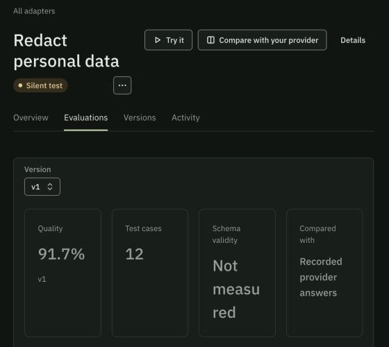
</p>
<p align="center">
  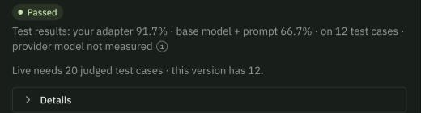
</p>

The last line is why the adapter does not serve the app yet: Mubit sets live at
20 judged test cases, and v1 was examined on 12.

The trained adapter answering, in Mubit's Try models page on a synthetic tenancy
excerpt: the 4B adapter (below) returns the same redaction as Gemini 3.8 Flash
(above, one of the providers that page compares against): all ten values hidden,
the second mention "Ms Ward" given the landlord's placeholder, the rent and dates
left in place.

<p align="center">
  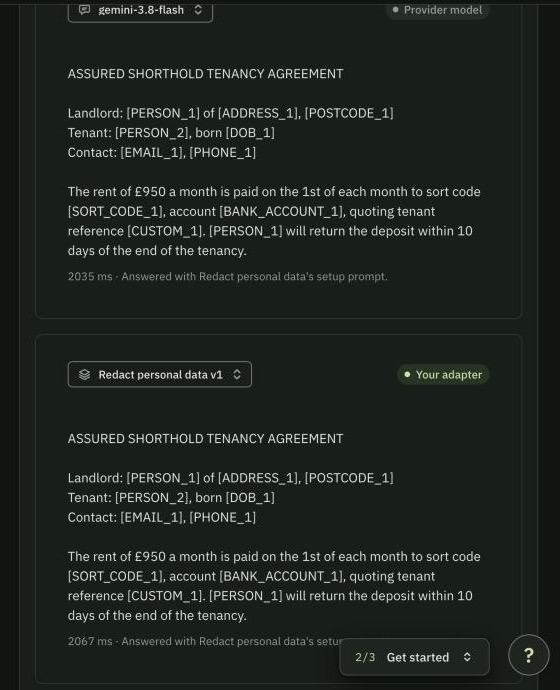
</p>

### How Mubit works in MuGuard

Mubit sits between MuGuard and the model providers. MuGuard uses the normal Anthropic
request format but points it at `https://api.mubit.ai/anthropic` with a Mubit
key (`mbt_…`). Mubit routes each call to a provider model or to a task adapter
it has trained, records the call if recording is on, and returns a request ID
(`x-middleware-request-id`, an `mreq_…` value) that MuGuard stores with each chunk.

Every T1 call is recorded, so the redaction task builds up real examples. After
review, Mubit trains an adapter on them and can route later T1 calls to it.
T2 calls are sent with recording off. On 24 October the task's first adapter,
v1 on Qwen3-4B-Instruct-2507, scored 91.7% on its held-out test against 66.7%
for the base model with the same prompt. It is on a silent test: Mubit puts a
version live once it has 20 judged test cases, and v1 had 12. Until then
`claude-haiku-4-5` answers T1. On 25 October we sent a second realistic round for
the next version: 225 chunks from new fills of the same public templates, rated
against the answer key (137 good).

<details>
<summary><b>Detailed Mubit calls and training loop</b></summary>

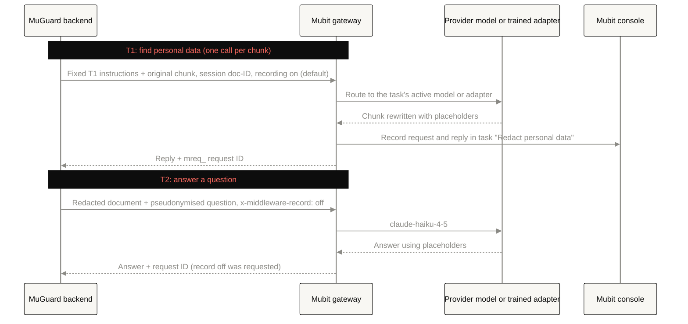

Recorded T1 calls feed Mubit's training loop. Each call with the same fixed
instructions and model lands in the same **task**, so the task collects many
real examples of the one job MuGuard needs done:

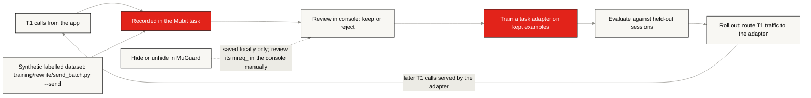

</details>

**T1 detects; T2 answers.** Both use Mubit. The default T1 request asks
`claude-haiku-4-5` to rewrite a chunk with placeholders; MuGuard aligns that answer
back to the original text and combines it with deterministic rules. T2 receives
the redacted result and a pseudonymised question with recording off requested.
Model routing and adapter rollout are configured in Mubit, not proven by the
model name displayed in the app.

Every miss you fix is saved at once, with no new model call. The knight learns
from the calls our team rates in the Mubit console; the calls Mubit keeps train its
next version. See the [Mubit guide](docs/MUBIT.md) for task/session grouping,
dataset paths, review, training, evaluation and routing.

## Data protection

Accounts isolate documents; Argon2id protects passwords; server-side sessions
use HttpOnly cookies; Fernet encrypts document content, vaults and chat at rest.
The backend can decrypt this data. Approval is saved, and `/ask` answers only
for an approved document. Approval is not tied to a result revision, and Approve
all works while some parts were not checked by the model. Question filtering can
miss unfamiliar free-form values. Read the [security guide](docs/SECURITY.md)
before making privacy claims about a deployment.

## Repository layout

```text
backend/              FastAPI API: ingest, detection pipeline, vault, Q&A, true PDF redaction
├── samples/          the synthetic sample PDFs the app offers, with their answer keys
frontend/             React + Vite app (/app) and landing page (/), unit and Playwright tests
training/             Tooling that builds, sends and scores data for the T1 model
├── sources/          public templates filled with invented values (rewrite approach)
├── rewrite/          validate, chunk, send and score the rewrite dataset
├── datagen/          synthetic UK documents with gold spans
├── dataconv/         converters for open PII datasets
├── evalkit/          list-output prompt, scorer, regex baseline and Mubit sender
└── review_redaction/ the separate review-redaction task, v2.1 to v2.4
data/                 Datasets, answer keys and recorded Mubit results
scripts/              Local database, OCR evaluation, sample builder, README numbers
demo/                 Records, voices and edits the submission video
docs/                 Architecture, Mubit, data protection, deployment, research
DESIGN.md, PRODUCT.md Design system and product context, read by the design tooling
Makefile              dev, test, lint and more: `make help`
```

Why each folder sits where it does, and what moved on 25 October, is in
[repository structure](docs/architecture/repo-structure.md). The three training
approaches and their results are compared in the [training guide](training/README.md).

## Run locally

Prerequisites: Python 3.12 or 3.13, uv, Node compatible with the frontend lockfile,
and PostgreSQL 16+ binaries on PATH. All setup commands below start at the
repository root. See [database setup](docs/DATABASE.md) for details.

```sh
# First setup only: preserve an existing .env rather than replacing it.
test -f .env || cp .env.example .env
# Edit .env to set MUBIT_API_KEY if model calls are wanted.
python3 scripts/local_db.py start
```

Backend, in one terminal:

```sh
cd backend
uv sync --frozen
uv run --env-file ../.env uvicorn app.main:app --reload --host 127.0.0.1 --port 8000
```

Frontend, in another terminal:

```sh
npm --prefix frontend ci
npm --prefix frontend run dev -- --host 127.0.0.1 --port 5173
```

The same with `make`: `make setup` once, `make db`, then `make dev` runs both
servers in one terminal.

Open <http://127.0.0.1:5173/app>. Without a Mubit key, rule-based detection still
works and Q&A is unavailable. Photos, scans and mixed PDFs needing OCR require
Apple Vision on macOS; that path is unavailable on the Linux Railway deployment.

## Verify changes

Run each command from the repository root:

```sh
(cd backend && uv run --env-file ../.env pytest -q)
(cd training/evalkit && uv run pytest -q)
npm --prefix frontend test
npm --prefix frontend run build
```

`make test` runs the test suites above plus the training tooling tests, `make build`
builds the frontend, and `make lint` type-checks the frontend and checks Python for
syntax errors and undefined names.

Backend integration tests need a separate `TEST_DATABASE_URL`, created by the
local setup script. Without it, those tests skip; do not interpret skips as a
passed database check. Model calls are mocked in backend tests. Dataset checks
and generation commands are in the [dataset guide](data/README.md).

The pictures in this README are drawn from the landing page's own sprites and
fonts by [`frontend/scripts/readme_art.py`](frontend/scripts/readme_art.py).

## Explore the project

- [Architecture](docs/ARCHITECTURE.md): system, document and Q&A diagrams.
- [Mubit](docs/MUBIT.md): inference, sessions, training and verification.
- [Data protection](docs/SECURITY.md): trust boundaries, controls and gaps.
- [Saved data](docs/DATABASE-CONTENTS.md) and [database operations](docs/DATABASE.md).
- [Developer handoff](docs/HANDOFF.md), [deployment](docs/DEPLOY.md), [design system](DESIGN.md).
- [Repository structure](docs/architecture/repo-structure.md) and [training tooling](training/README.md).
- [All documentation](docs/README.md), including datasets and historical research.

## License

[PolyForm Noncommercial 1.0.0](LICENSE) © 2026 Glib. Free for personal use,
study, research, hobby projects and noncommercial organisations such as
charities, schools and public bodies. Any commercial use needs a separate licence
from the copyright holder. Sample documents contain invented people only; external
datasets keep their own licences (see [dataconv](training/dataconv/README.md)).

<p align="center">
  
</p>
