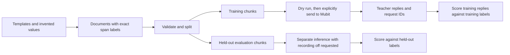

# T1 dataset: documents, chunks, answer keys and teacher results

Data for Veil's redaction task T1 ("redact one document chunk"). Current app integration: [Mubit guide](../docs/MUBIT.md).
The original dataset design was developed on the historical `docs/dataset-design`
branch; this page documents the schema and scripts available in this checkout.
All personal data in these files is fake. The answer key is written by code from
the documents' entity offsets, never by an LLM.

[Documentation index](../docs/README.md) · [Synthetic generator](../datagen/README.md) · [External converters](../dataconv/README.md)



The train path produces recorded calls for review; accepted examples and model
training live in Mubit. Local scoring compares replies with the answer key.
Evaluation data stays separate from training traffic.

## Layout

| Path | What | Written by |
|---|---|---|
| `data/docs/<group>.jsonl` | Input documents with entity offsets (the key) | dataset-contracts, dataset-correspondence, dataset-finance sessions |
| `data/chunks/{train,fresh,eval}.jsonl` | Chunks with the expected redaction | `scripts/dataset/build_chunks.py` |
| `data/results/<split>.jsonl` | Teacher answers from Mubit | `scripts/dataset/send_batch.py` |
| `data/results/score-<split>.{json,md}` | Scores against the key | `scripts/dataset/score.py` |
| `data/fixtures/` | Tiny hand-made documents and fake teacher answers for the tests | `data/fixtures/make_fixtures.py` |
| `data/raw/` | Raw downloads. Git-ignored: never commit files with real people's data | by hand |

The T1 system prompt, model and prompt version live in `backend/app/llm/prompts.py`.

## Documents schema (`data/docs/<group>.jsonl`)

UTF-8, one JSON object per line:

| Field | Type | Notes |
|---|---|---|
| `doc_id` | string | Unique, e.g. `contracts-C4-f2`, `financial-gretel-01234` |
| `source_id` | string | `C1`..`C12`, `R1`..`R11`, `INS1`, `INS2` (source identifiers) or `gretel-<row id>` |
| `group` | string | `contracts`, `correspondence`, `financial` or `insurance` |
| `subtype` | string | Lower-case slug: `tenancy`, `employment`, `nda`, `lease`, `engagement_letter`, `email_thread`, `letter`, `bank_statement`, `invoice`, `loan_application`, `insurance_policy`, `insurance_claim`, ... |
| `split` | string | `train`, `fresh` or `eval` |
| `fill` | int | 1..5 for filled sources, 0 for Gretel |
| `text` | string | The full document as plain text with `\n` line breaks |
| `entities` | list | `{start, end, type, value, entity_id}`; `text[start:end] == value`; sorted by `start`; non-overlapping |
| `hard_cases` | list of strings | Optional tags for the team pack 9.4 hard cases present |
| `provenance` | object | `{url, licence, kind}`, kind is `template`, `filled_real` or `synthetic` |

Entity `type` is one of PERSON, ADDRESS, POSTCODE, EMAIL, PHONE, BANK_ACCOUNT,
SORT_CODE, IBAN, CARD, NI_NUMBER, DOB, ID_DOC, CUSTOM. `entity_id` links all
surface forms of the same person or thing within a document ("Raj Patel",
"Mr Patel", "R. Patel"); one `entity_id` has one type.

Labelling rules:
- Every personal value that must be hidden is an entity. An unlabelled one is a key bug.
- Amounts, ordinary dates, contract terms, public company names (unless clearly a
  sole trader's own name), product names and job titles stay unlabelled.
- A postcode is its own POSTCODE entity even inside an address; the rest of the address is ADDRESS.
- Possessive suffixes stay outside the entity ("Kovalenko" + "'s").
- DOB only for dates of birth. All email addresses are EMAIL, all phone numbers are PHONE.
- References tied to a specific client, customer, account holder, policy, claim or matter are CUSTOM.
- No leftover slot markers (`{{`, `}}`, ``) and no placeholder-like tokens (`[PERSON_1]`, `[Address]`) in `text`.

Splits:
- Eval sources `C2`, `C5`, `C10`, `R5`, `R7`, `R9`: every fill is `eval`, never `train` or `fresh`.
- Other filled sources: fills 1 to 3 are `train`, fills 4 and 5 are `fresh`.
- Gretel: split by document, about 50% train, 30% fresh, 20% eval, seeded.
- Target: about 225 documents in total.

## Chunks schema (`data/chunks/<split>.jsonl`)

`chunk_id` (`<doc_id>-c<NNN>`), `doc_id`, `source_id`, `group`, `subtype`, `split`,
`fill`, `chunk_index` (position in the document), `doc_start` (offset of the
chunk in the document text), `text`, `entities` (offsets relative to the chunk),
`expected_redacted`, `est_tokens`.

- Chunks hold at most about 1,000 tokens, estimated as characters / 3.5 rounded
  up (no API call; over-counts English prose by about 15% for a safety margin).
- Cuts fall on paragraph boundaries (blank lines). A paragraph over the limit is
  cut on sentences, then lines, then words. A cut never falls inside an entity.
- `expected_redacted` replaces each entity with `[TYPE_N]`; N counts per chunk and
  per type in order of first appearance, and every entity with the same
  `entity_id` in the chunk gets the same N. A value over several lines keeps its
  line breaks, with the placeholder on each line.
- Chunks with no entities are emitted once per `source_id` (the earliest fill
  keeps it; identical copies in later fills are dropped). Long runs of
  paragraphs with no personal data are chunked on their own so that their cuts,
  and so their text, are identical across fills.

## Results schema (`data/results/<split>.jsonl`)

One line per call, appended: `chunk_id`, `doc_id`, `split`, `request_id` (Mubit's
`mreq_...` from `x-middleware-request-id`), `output`, `stop_reason`, `latency_ms`,
`usage`, `model`, `prompt_version`, `record_off`, `error` (null on success),
`sent_at`. A chunk may have several lines (a failed attempt, then a retry with
`--retry-errors`); the scorer uses the latest successful one.

## Scripts

```bash
pip install -r requirements.txt          # Python 3.11+

python scripts/dataset/validate_docs.py  # schema and labelling checks; exit 1 on any error
python scripts/dataset/build_chunks.py   # validates, then writes data/chunks/ and prints the summary
python scripts/dataset/send_batch.py --split train             # DRY RUN: what would be sent, and the cost
python scripts/dataset/send_batch.py --split train --send      # real calls (needs MUBIT_API_KEY=mbt_...)
python scripts/dataset/score.py --split train                  # writes data/results/score-train.{json,md}
python -m pytest tests/dataset                                 # tests on data/fixtures/
```

Useful flags: `build_chunks.py --max-tokens N`; `send_batch.py --limit N
--concurrency 8 --retry-errors --no-eval-record-off`; every script takes
`--docs-dir`, `--chunks-dir`, `--results-dir` or `--out-dir` so it can run on
the fixtures. When trying the pipeline on the fixtures, write the output outside
`data/chunks/` (for example `--out-dir /tmp/chunks`) so fixture chunks are never committed.

## Original build checklist (historical)

This checklist records the initial dataset build. For new traffic, follow the
[current Mubit workflow](../docs/MUBIT.md); counts below are targets, not a live
training status.

1. Merge the four dataset PRs (core, contracts, correspondence, finance). They touch disjoint files.
2. `pip install -r requirements.txt`
3. `python scripts/dataset/validate_docs.py`. Fix every error in the generating
   session's code (not by hand in the JSONL). Skim the warnings: each is a possible
   unlabelled phone number, IBAN, postcode and so on.
4. `python scripts/dataset/build_chunks.py`. Check the summary against the
   targets: about 225 documents; train 300 to 500 chunks, fresh about 200, eval about 150.
5. Nick reviews `backend/app/llm/prompts.py`. After the next step it is frozen: any
   change to the prompt, model or request shape makes a new Mubit task.
6. Copy `.env.example` to `.env` (git-ignored) and put the Mubit Inference key in
   `MUBIT_API_KEY`; the sender reads it when the variable is not set in the shell.
   Dry run, then a 10-call test:
   `python scripts/dataset/send_batch.py --split train` (check the cost), then
   `python scripts/dataset/send_batch.py --split train --limit 10 --send`.
   In the Mubit console confirm: exactly one new task, with a sensible name taken
   from "Redact personal data in one document chunk"; 10 requests; sessions named
   `doc-<doc_id>`. In `data/results/train.jsonl` every row has an `mreq_` id and
   no error. A `400 starter_credit_model` error lists the models the starter credit allows.
7. The train split: `python scripts/dataset/send_batch.py --split train --send`.
   It resumes and skips the 10 chunks already sent.
8. `python scripts/dataset/score.py --split train` and read `data/results/score-train.md`,
   in particular the over-redactions that look like personal data (possibly a real
   value the fill step missed) and the outputs that changed text outside placeholders.

Later: the fresh split (for v2), and the eval split once Mubit answers whether
`x-middleware-record: off` is acceptable (design section 8; `--no-eval-record-off` sends eval as normal calls).
