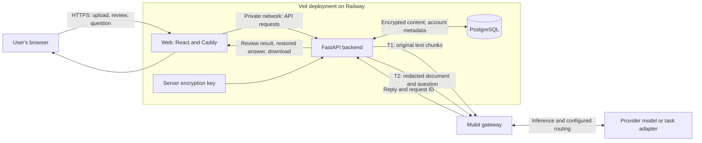
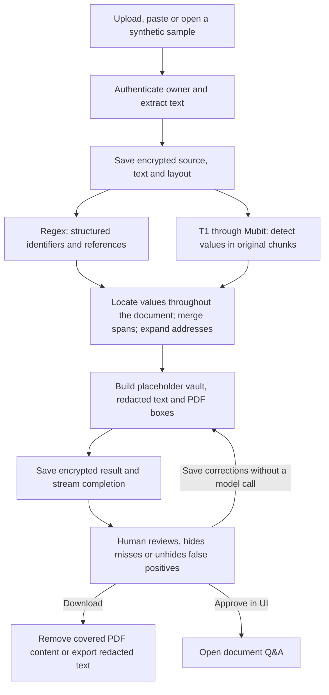
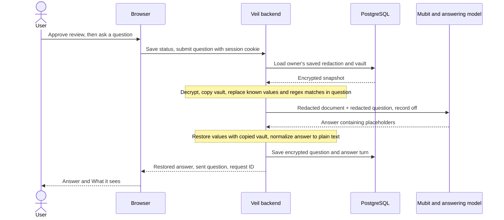

# How Veil works

[Documentation index](README.md) · [Mubit](MUBIT.md) · [Data protection](SECURITY.md)

Veil has a React browser interface, a FastAPI backend and PostgreSQL storage.
The backend extracts document text, finds sensitive values, builds a redacted
copy and keeps the mapping needed to restore values in answers. Mubit is the
gateway for both detection (**T1**) and document questions (**T2**).

## System and trust boundaries

The browser connects to the public web service. Caddy forwards API requests to
the private backend, which owns the database credentials and Mubit key. Original
content exists in the browser and backend memory. At rest, document content is
encrypted before PostgreSQL receives it. **T1 still receives original text**;
this is not browser-only or end-to-end encrypted processing.

## A document from upload to download

1. **Extract.** Text-layer PDFs use PyMuPDF text and word coordinates. Text,
   email and supported source/config files become plain text. Images and scanned
   PDFs use Apple Vision OCR when running on macOS. Railway runs Linux, where
   this OCR path is unavailable, including for mixed PDFs needing OCR.
2. **Detect.** The default rewrite task processes chunks of at most 1,400
   characters, with up to six concurrent workers. T1's placeholder rewrite is
   aligned back to the original text; the app does not trust it to replace the
   contract's wording. Regexes independently find structured values. This regex
   pass does not sanitize the chunks sent to T1.
3. **Build.** Values found in one chunk are located across the whole document.
   Overlaps are merged; address rules widen incomplete address spans. A vault
   assigns stable placeholders to matching values within this result. This is
   value matching, not a general identity-resolution system.
4. **Review.** A hide/unhide correction rebuilds the result without calling T1.
   Full rescans and failed-part retries preserve those choices. Removing a
   redaction deliberately makes that value available to subsequent Q&A.
5. **Export.** PDF word boxes become actual redaction annotations, applied to
   remove covered text and image pixels. Selected metadata is stripped too.
   Undetected values outside those boxes remain in the output.

## Questions and answers

For example, an illustrative document `Tenant: Raj Patel. Rent: £950.` becomes
`Tenant: [PERSON_1]. Rent: £950.`. The question `What does Raj Patel pay?` becomes
`What does [PERSON_1] pay?`. A reply mentioning `[PERSON_1]` is restored on the
**backend**, then returned to the signed-in browser. The vault is not included
in the T2 request. New free-form names or addresses in questions can still be
missed: question protection uses known values and rules, not another T1 scan.

Approval is saved and controls the UI, but `/ask` currently requires an owned,
scanned document rather than checking `status == approved`. This sequence shows
the intended UI path; it is not a server-enforced consent barrier.

## Streaming, retries and persistence

The POST stream emits `start`, `regex`, one `chunk` event per completed part,
then `done` after saving the final result. Parts can finish out of order. Chunk
errors remain visible and are not interpreted as proof that a part is safe.

`?retry=failed` reuses successful and empty chunks only when the saved prompt
plan and chunk boundaries match. A full rescan calls T1 again; both paths retain
manual corrections. A revision check prevents an older scan from overwriting a
newer scan or correction. There is no database transaction held during inference.

Documents, latest results, review status and chat turns survive refreshes and
backend restarts. The sidebar lists the owner's saved documents; a deep link
`/app?doc=<id>` reopens one. Approval status is retained across a rescan, so it
does not attest that a person reviewed every later version of the result.

## Code map

| Responsibility | Implementation |
| --- | --- |
| API, ownership and stream orchestration | [main.py](../backend/app/main.py) |
| Chunking, merging, corrections and PDF boxes | [pipeline.py](../backend/app/pipeline.py) |
| Mubit requests and rewrite alignment | [llm.py](../backend/app/llm.py), [prompts.py](../backend/app/prompts.py) |
| Question protection | [question.py](../backend/app/question.py) |
| PDF export | [pdfout.py](../backend/app/pdfout.py) |
| Encryption, revisions and saved chat | [storage.py](../backend/app/storage.py) |
| Account and session checks | [auth.py](../backend/app/auth.py) |
| Browser state and streamed results | [App.tsx](../frontend/src/App.tsx), [scan.ts](../frontend/src/scan.ts) |

See the [developer handoff](HANDOFF.md) for full API and OCR details.
