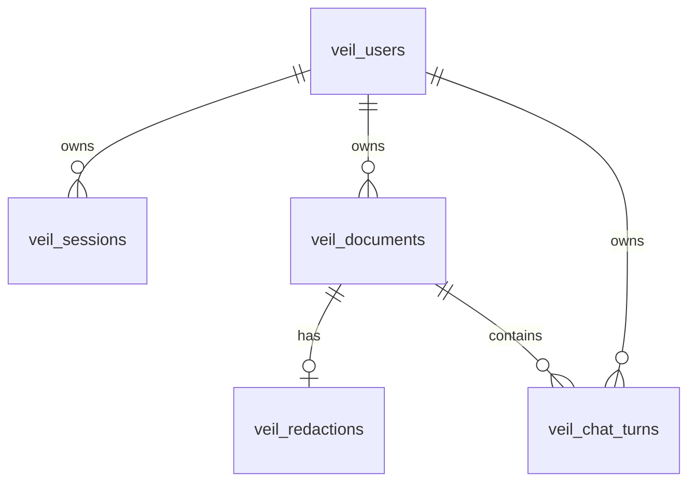

# What MuGuard saves

[Documentation index](README.md) · [Database operations](DATABASE.md) · [Data protection](SECURITY.md)

MuGuard uses PostgreSQL for accounts, sessions, documents, their latest redaction,
review status and chat history. Content is encrypted by the backend before it
is written. The server-held key is separate from the database.

## Saved data

| Data | Saved fields | Protection |
| --- | --- | --- |
| Accounts | User ID, normalized email, password hash, creation time | Argon2id password hash; email and account metadata are plaintext |
| Sessions | Token hash, owner and expiry | SHA-256 of a random token; raw token is only in the session cookie |
| Documents | Filename, original text, source PDF when present, extracted layout | Fernet-encrypted payload |
| List summary | Filename, kind, page and change counts | Encrypted metadata payload |
| Record metadata | Document/owner IDs, revision, status, timestamps | Plain database fields; owner-scoped API access |
| Redaction | Spans, redacted text, boxes, statistics, chunk values/plan and request IDs | Encrypted result payload |
| Vault and corrections | Placeholder-to-value mapping, current hides and unhides | Encrypted with the result; no separate edit history |
| Chat | Original question, sent question, restored answer, answer with placeholders, unknown placeholders, request ID | Encrypted turn payload; older turns may lack sent question |
| Turn metadata | Turn ID, document/owner IDs, time | Plain database fields |
| Auth limits | Hashed client-address bucket, attempts, reset time | Short-lived counters |
| Maintenance | Migration filenames/checksums and key verification probe | Probe encrypted; no encryption key stored in PostgreSQL |

## Relationships

`veil_auth_limits`, `veil_schema_migrations` and `veil_storage_settings` support
authentication and database operations. Legacy documents can have no owner;
they are inaccessible through the owner-scoped API until explicitly assigned.

## What is not stored here

- Plaintext passwords, raw session tokens, Mubit keys or the encryption key.
- Model weights or Mubit training-job state.
- A complete correction history or consent audit trail.
- A per-turn copy of the whole redacted document sent to T2. The saved turn
  contains the question sent, but the UI's document preview uses the current result.

Approval/decline **is saved**, and `/ask` requires `approved`; approval is not
consent for training. Chat questions and answers **are saved**.

## Retention and recovery

A saved document survives browser refresh and backend restart. Full rescans and
failed-part retries preserve manual corrections. The latest snapshot replaces
the earlier result under a revision check, preventing stale overwrites.

Documents remain until explicitly deleted. Deleting a document cascades to its
redaction and chat turns. Backups and PostgreSQL write-ahead logs may retain
historical encrypted records until their own retention ends; this operation
does not delete any data already recorded by external services.

Sessions expire after seven days; logout revokes the active session. Expired
session cleanup happens on a new login/registration. Auth-limit cleanup occurs
on later authentication attempts. No automatic document expiry is implemented.

The backend can decrypt content. Keep the encryption key recoverable and paired
with the correct database; replacing it does not rotate existing ciphertext.
See [DATABASE.md](DATABASE.md) for schema, setup, migration and recovery details.
