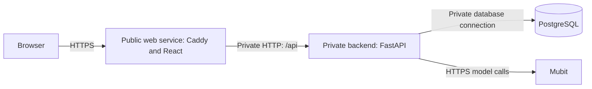

# Railway deployment

[Documentation index](README.md) · [Architecture](ARCHITECTURE.md) · [Security](SECURITY.md)

Live app: <https://web-production-dc019.up.railway.app/app>
Railway project: `night-shift` (environment `production`).

| Service | Built from | Public | Role |
| --- | --- | --- | --- |
| `web` | `frontend/Dockerfile` | yes | Vite build served by Caddy (`frontend/Caddyfile`); proxies `/api/*` to the backend |
| `backend` | `backend/Dockerfile` | no | FastAPI on port 8000, private network only (`backend.railway.internal`) |
| `Postgres` | Railway template | TCP proxy (TLS) | App database, see the Railway section in `DATABASE.md` |

The browser only ever talks to `web`, so the site and API share an origin. Cookies, the
`X-Veil-Request` CSRF header and `credentials: "same-origin"` work unchanged. Caddy
sets `X-Forwarded-For` from Railway's `X-Real-IP`, and uvicorn trusts forwarded headers
so auth throttling sees the real client. That trust is safe only because `backend`
has no public domain. **Don't add one.**

## Service topology



TLS terminates at the public edge. The web service proxies the API so cookies
stay on the same browser origin. Private-network traffic is not represented
here as end-to-end encrypted. The database's optional public TCP proxy is an
administrative access path, not the browser's route to documents.

## Variables

- `backend`: `DATABASE_URL=${{Postgres.DATABASE_URL}}` (private network),
  `VEIL_STORAGE_KEY` (the same key as `.env.railway`; it must stay paired with this
  database), `MUBIT_API_KEY`, `VEIL_COOKIE_SECURE=true`, `PORT=8000`,
  `RAILWAY_DOCKERFILE_PATH=backend/Dockerfile`. Optional: `VEIL_T1_PROMPT`,
  `VEIL_T1_MODEL`, `VEIL_T2_MODEL`.
- `web`: `BACKEND_URL=http://backend.railway.internal:8000`,
  `RAILWAY_DOCKERFILE_PATH=frontend/Dockerfile`.

Set secrets from stdin so they don't show up in shell history, e.g.
`printf %s "$VALUE" | railway variables --service backend --set-from-stdin MUBIT_API_KEY`.

## Redeploy

From the repo root (the build context for both images is the root):

```sh
railway up --service backend --environment production --ci
railway up --service web --environment production --ci
```

`.railwayignore` and `.dockerignore` keep `.env*`, `.local/`, `node_modules`, datasets
and results out of the upload. Only `data/synthetic/pdfs` (the samples) ships.
Deploy only services whose code changed. A backend correction does not require
a frontend redeploy. The command uploads the checkout, so review `git status`
and the ignore rules first.

If a deployment hangs in DEPLOYING with no logs, `railway redeploy --service <name> --yes`.

## Verify a rollout

```sh
railway deployment list --service backend --environment production --limit 1
curl --fail --silent --show-error https://web-production-dc019.up.railway.app/api/health
curl --fail --silent --show-error -o /dev/null -w '%{http_code}\n' https://web-production-dc019.up.railway.app/app
```

Wait for deployment status `SUCCESS`. Health checks verify the API/database and
report configured models; they do not make an inference call or prove adapter
routing. Use a synthetic document for a functional smoke test. Any scan with a
configured key sends real T1 requests and may be recorded.

## Limits

- OCR uses Apple Vision (macOS only), so on Railway scanned PDFs and photos return the
  OCR error. Text PDFs, `.txt`/`.eml` and pasted text work.
- Anyone with the URL can register (there's no email verification), and each scan uses
  the Mubit key's credits. Registration throttling is per IP only.
- One backend replica. The database has no automated backup beyond Railway's own; keep
  the `VEIL_STORAGE_KEY` outside Railway.
