# How MuGuard uses Mubit

[Documentation index](README.md) · [Architecture](ARCHITECTURE.md) · [Data protection](SECURITY.md)

MuGuard uses Mubit as an inference gateway and a place to collect, review and train
task-specific detection examples. The application uses provider SDK/request
formats with a Mubit base URL and inference key. It does not train weights in
the browser or store model weights in PostgreSQL.

## Two model calls, different data

| | T1: detect sensitive values | T2: answer a document question |
| --- | --- | --- |
| Input | Original document chunk | Redacted document plus pseudonymised question |
| Default requested model | `claude-haiku-4-5` | `claude-haiku-4-5` |
| Default route | Anthropic SDK through `https://api.mubit.ai/anthropic` | Provider wrapper through Mubit |
| Output | Chunk rewritten with placeholders, aligned back to source values | Plain-text answer using placeholders |
| Recording request | Default recording; no record-off header | `x-middleware-record: off` |
| Local result | Detected values, chunk status, timing, Mubit request ID | Restored answer, sent question, Mubit request ID |
| Purpose | Detection and eligible recorded examples for console review | Answering, without adding this call to task training |

These are the requests built by [llm/t1.py](../backend/app/llm/t1.py) and
[llm/providers.py](../backend/app/llm/providers.py). A requested model name does
not establish which adapter, if any, served a particular call.

Mubit records request/reply content by default. Its documentation describes
tasks as groups of calls sharing instructions, tools, tool choice, output
format and model; varying document content belongs in the user message.
See [Mubit quickstart](https://docs.mubit.ai/quickstart) and
[tasks and sessions](https://docs.mubit.ai/guides/tasks-and-sessions).

Record-off is a request to Mubit, **not a guarantee of zero retention by every
service involved**. T2 still goes through the gateway and a serving model.
MuGuard itself saves chat history encrypted in its own database.

## The default detection request

The app freezes the instruction text in [prompts.py](../backend/app/llm/prompts.py)
and sends one chunk per call. The essential shape is:

```python
client = anthropic.Anthropic(
    api_key=mubit_key,
    base_url="https://api.mubit.ai/anthropic",
    max_retries=0,
    timeout=120.0,
)
response = client.messages.with_raw_response.create(
    model=prompts.MODEL_ID,
    max_tokens=2048,
    system=prompts.T1_SYSTEM_PROMPT,
    messages=[{"role": "user", "content": chunk.strip()}],
    metadata={"user_id": f"doc-{doc_id}"},
)
```

This excerpt explains the request; it is not a standalone sender. The app reads
the `x-middleware-request-id` response header and stores it with the chunk.
The document-based session ID groups a document's calls. Mubit documents
Anthropic's `metadata.user_id` as a session field and holds test cases out by
session. [Tasks and sessions](https://docs.mubit.ai/guides/tasks-and-sessions)

The rewrite plan uses 1,400-character chunks and aligns placeholder output with
the input. Truncated or badly misaligned replies become chunk errors. Explicit
retries handle HTTP 429, 503 and 529, up to four attempts. The prompt/request
shape matches the rewrite dataset sender; changing the instructions or model
can change which Mubit task receives calls.

## Training and review

```mermaid
%%{init: {"theme": "base", "themeVariables": {"fontFamily": "ui-monospace, SFMono-Regular, Menlo, monospace", "primaryColor": "#f8f7f3", "primaryTextColor": "#0d0d0d", "primaryBorderColor": "#0d0d0d", "lineColor": "#8b8a85", "clusterBkg": "#ecebe5", "clusterBorder": "#0d0d0d", "edgeLabelBackground": "#ecebe5"}}}%%
flowchart LR
    D["Synthetic labelled documents"] --> S["Validate and split by document or source"]
    S --> C["Chunk and send with fixed T1 instructions"]
    C --> R["Recorded requests and provider answers"]
    R --> E["Mubit review: waiting, kept or rejected"]
    E --> T["Eligible kept examples train an adapter"]
    T --> V["Evaluation and comparison"]
    V --> P["Configured rollout and routing"]
    P --> O["Observe quality and routing in console"]
    U["In-app hide or unhide"] --> L["Save local redaction correction"]
    L -.->|"Manual console feedback; not automatic"| E
    classDef mubit fill:#e2231a,stroke:#0d0d0d,color:#ffffff
    classDef ink fill:#0d0d0d,stroke:#0d0d0d,color:#ecebe5
    class T mubit
    class U,L ink
```



Mubit distinguishes recorded calls from **kept training examples**. Training
and evaluation progress must be read from the task's console, not inferred from
the number of requests sent. Its first-adapter guide describes the review and
training process; workspace thresholds can differ.
[Create your first adapter](https://docs.mubit.ai/guides/first-adapter)

In MuGuard, `/corrections` rebuilds and saves the current redaction. It makes **no
Mubit feedback call**. To use a mistake for training, find the relevant `mreq_`
request in the console and review it there. A “Fix a miss” click does not prove
that model weights changed. A completed training job, a passed evaluation and
an actively serving route are separate facts. “Silent test 100%” describes a
traffic share, not 100% detection accuracy.

For a training check-in, record the task and version, timestamp, kept/rejected/
waiting counts, training state, graded test count, evaluation result and active
route. The repository's historical model results are snapshots, not live status.
Do not combine results from different task IDs or prompt designs.

## Dataset paths and a reproducible workflow

| Path | Purpose |
| --- | --- |
| [data/docs and dataset scripts](../data/README.md) | Public templates filled with invented values; rewrite answer keys built from labelled offsets |
| [training/datagen](../training/datagen/README.md) | Generated UK documents, spans, hard cases and synthetic sample PDFs |
| [training/dataconv](../training/dataconv/README.md) | External dataset conversion with provenance and usage restrictions |
| [review-redaction datasets](../data/review_redaction_v2_4/README.md) | Separate exact-text detection task (v2.1 to v2.4), built and sent by `training/review_redaction/` |
| [evalkit](../training/evalkit/README.md) | Scoring, baseline, older list-output experiments and batch tools |

From the repository root, with the root Python requirements installed:

```sh
python training/rewrite/validate_docs.py
python training/rewrite/build_chunks.py
python training/rewrite/send_batch.py --split train --limit 10
```

The final command is a **dry run**. Adding `--send` makes real recorded calls.
Keep evaluation documents and related source variants out of training, check
licences before sending external data, and compare outputs against code-built
labels. Uploading a document to MuGuard does not upload its gold labels to Mubit.

App runtime chunks and offline dataset chunks have different controls: runtime
uses a character limit; the dataset builder uses `--max-tokens`. Check the
actual request sizes and console review results before a large batch.

## Configuration and troubleshooting

`VEIL_T1_PROMPT=rewrite` is the default. `evalkit` selects the older JSON values
prompt with a 4,000-character runtime limit and default `gpt-6-luna`.
`VEIL_T1_MODEL` changes only the evalkit model; the rewrite model comes from
`prompts.MODEL_ID`. `VEIL_T2_MODEL` selects the answer model.

The key and these model settings resolve from environment variables, then
`backend/.env`, then root `.env`. Keep all secrets server-side. With no valid
Mubit key, T1 and T2 are off: regex detection still works, but Q&A does not.

| Symptom | Check |
| --- | --- |
| Calls increase but training does not start | Kept examples, review queue/limits and workspace training settings |
| A second task appears | Prompt, model, tools and output format compared with the training sender |
| Retry sends no new calls | Successful chunks were reused; only failed/off chunks need inference |
| No request ID for a part | It may be empty, model-off, reused, or failed before a response header |
| Model reports “on” | A key is configured; this does not verify credit, successful inference or adapter routing |

For outbound data boundaries and remaining protections, read [Security](SECURITY.md).
