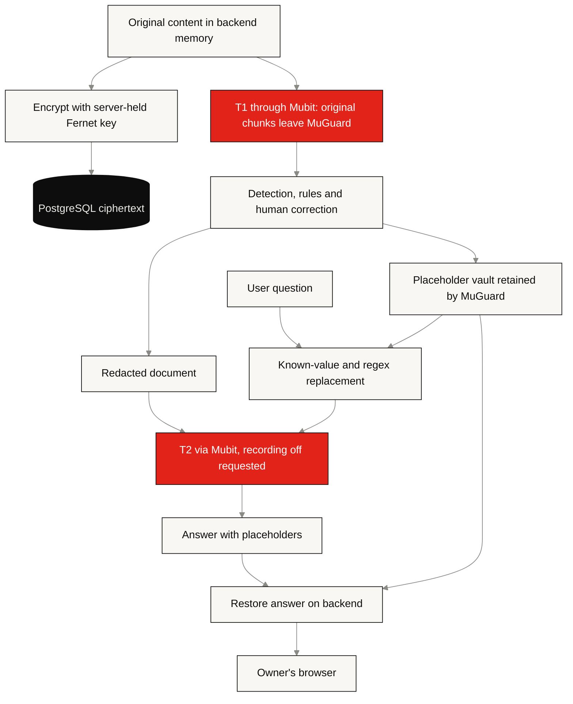

# Data protection: what MuGuard does today

[Documentation index](README.md) · [Architecture](ARCHITECTURE.md) · [Saved data](DATABASE-CONTENTS.md)

MuGuard reduces the sensitive text sent to the **answering model** by replacing
detected values with placeholders. It also encrypts saved document content and
checks account ownership. It does **not** currently guarantee that original
personal data never reaches an external AI service: T1 detection sends original
chunks through Mubit, with recording enabled by default.

This describes the implementation checked on 24 October 2026, not a security
certification or a claim of complete anonymisation.

## Who receives what

| Location | Data visible there |
| --- | --- |
| Signed-in browser | Original document, redactions, restored answers and its own account |
| MuGuard backend memory | Original content, decrypted vault, questions, answers and server keys |
| PostgreSQL | Encrypted content; plaintext account emails, IDs, status and timestamps; password and session-token hashes |
| Mubit T1 path | Original chunks, instructions and detector replies; default recording applies |
| Serving T1 model | Text needed for detection; provider fallback/routing must be checked in Mubit |
| Mubit/T2 model | Redacted document, pseudonymised question and answer; MuGuard requests recording off |
| Download recipient | Redacted output; anything not detected or deliberately unhidden remains visible |

Encryption at rest protects stored content; it does not change outbound T1
payloads. The backend possesses the decryption key, so this is not end-to-end
encryption against the server operator.

## Implemented controls

| Control | Behavior and evidence |
| --- | --- |
| Account isolation | Every document operation checks the signed-in owner; foreign documents return 404. [API](../backend/app/main.py) |
| Password storage | Argon2id hashes; passwords are not stored in plaintext. [Auth](../backend/app/auth.py) |
| Login sessions | Random token in HttpOnly, SameSite=Lax cookie; only its SHA-256 hash is stored. Seven-day expiry and server-side logout revocation. Secure cookie on HTTPS or with `VEIL_COOKIE_SECURE=true`. [Auth](../backend/app/auth.py) |
| Request protection | Mutating API requests require `X-Veil-Request: 1`; CORS is restricted to configured origins. Auth/document responses use `Cache-Control: no-store`. [Middleware](../backend/app/main.py) |
| Login throttling | Login and registration share a 30-attempt/minute bucket per client address. This is not an inference quota. [Auth](../backend/app/auth.py) |
| Encrypted storage | Fernet encrypts document payloads, results, vaults, summaries and chat. Payload identity includes document ID and kind; a key probe rejects the wrong database/key pair. [Storage](../backend/app/storage.py) |
| Correction persistence | Manual hides and unhides survive retries/rescans; stale writes cannot overwrite a newer result. [Pipeline](../backend/app/pipeline.py) |
| Question protection | Known values and selected name parts plus regex-detected identifiers become placeholders using a vault copy. [Question processing](../backend/app/question.py) |
| PDF redaction | Covered text/image pixels are removed, then selected document/image metadata and attachments are stripped. [PDF export](../backend/app/pdfout.py) |

Routine chunk logs contain document/request IDs, status, counts and timing, not
chunk text. This is not a guarantee that every third-party error or operational
log is content-free; exception handling and log retention still need review.

## Review and consent are different

The UI asks the user to review redactions and approve before opening chat.
Approval/decline status is saved. However:

- Detection has already sent T1 text before this review screen appears.
- `/ask` checks authentication, ownership and a saved scan, but does not enforce
  the saved approval status. The download route also requires a scan, not approval.
- Status is not bound to a particular result revision; rescans do not invalidate
  an earlier approval.
- Decline does not erase stored data or recall requests already sent to Mubit.
- There is no versioned consent record for sending original text or recording
  detection traffic for training.

Use synthetic examples when demonstrating the current flow. A strict
“confirm before any sensitive text leaves” product promise requires a separate
pre-send consent gate and a verified detection/routing policy.

## Detection and output limits

Redaction quality depends on text extraction, model output, rules and review.
Names, addresses, unusual identifiers, OCR errors and context can be missed.
New names/addresses typed only in a question are not fully covered by the
known-value question filter. A user choosing to unhide a value exposes it in
subsequent output by design.

The vault makes the text reversible for MuGuard. Other context can also identify a
person even without their name. Describe the output as **pseudonymised**, not
anonymous, and inspect the actual output before sharing it.

PDF export removes content covered by the chosen boxes; it does not prove that
every sensitive value or every possible PDF metadata carrier was found. Output
filenames currently retain the original filename stem. Review those filenames
before sharing, too. OCR requires macOS; Linux deployments cannot process the
same range of scanned documents.

## Retention and operational limits

Documents and chats remain until deletion. Deleting a document cascades to its
stored result and chat turns, but backups/WAL and external service records have
separate retention. The app has no automatic expiry, key rotation, password
reset, email verification or MFA. The UI currently has no document-delete control;
an authenticated owner can use the DELETE API.

One application encryption key protects all stored content. Keep it outside
source control, separately recoverable from database backups, and paired with
the correct database. A compromised backend with its key can read the content.

Additional work remains on inference quotas, question/document limits, bounded
page rendering, log review and a robust consent/approval gate. These are
engineering gaps, not protections supplied by this documentation update.

See [Database operations](DATABASE.md) for recovery and [Deployment](DEPLOY.md)
for the public web/private backend topology.
